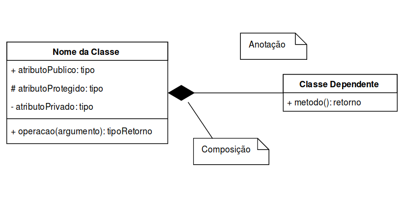
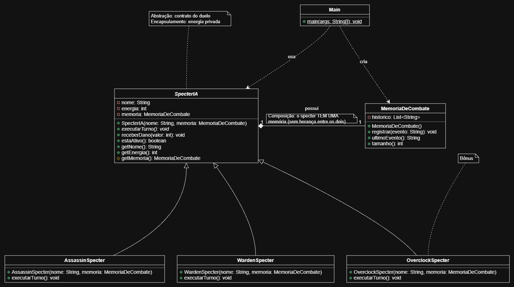
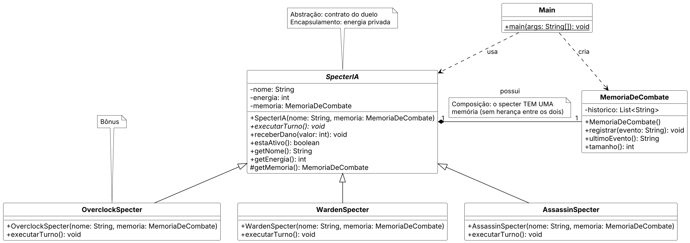

## Night Patch Cell
Dinâmica em grupo 

Integrantes:
- Ana Carolina Reis 
- Gustavo Gonçalves
- Matheus de Paula
- Pedro Costa
- Pedro Barros
- Sarah Sato

IA utilizada: Claude

Prompt: Com base no case descrito, monte um passo a passo de desenvolvimento com base nos seguintes papeis:
- Driver: Java
- Navigator: orienta/ajuda codar
- Tracker: Prompt/readme(git)
- Coach/facilitator
- AI Operator
E crie um diagrama de classes (com código PlantUML) para construção do código orientado a objetos.
Arquivo notion anexado.

Resultado: 
Segue o plano para os 40 minutos, dividido por papel, e depois o diagrama PlantUML.
Papéis da squad
Papel
Responsabilidade na dinâmica
Driver
Único que digita o código Java no IDE
Navigator
Lê a especificação, dita a estrutura e confere se cada requisito está sendo atendido
Tracker
Cria o repositório, escreve o README, controla os commits e registra o prompt usado e o ajuste feito na IA
AI Operator
Faz os prompts (1 classe por vez), traz as respostas e destaca o que precisa ser corrigido
Coach/Facilitator
Controla o tempo, garante que todos falem na apresentação e prepara a fala de OOP
Passo a passo (40 min)
1. Alinhamento (0–5 min)
Coach lê o objetivo e a Definition of Done em voz alta e define o cronômetro.
Navigator lista as classes candidatas a partir do storytelling: SpecterIA, WardenSpecter, AssassinSpecter, OverclockSpecter (bônus) e MemoriaDeCombate.
Tracker cria o repositório público no GitHub (com README vazio) e clona na máquina do Driver.
Decisão em 15s: classe abstrata ou interface. Recomendo classe abstrata, porque energia e memoria são estado comum a todos os specters.
2. Prompt à IA e diagrama (5–12 min)
AI Operator pede: "Liste as classes da Specter League com atributos e responsabilidades. Não gere código ainda."
Navigator compara a resposta com o diagrama abaixo e corrige o que a IA errou (por exemplo, SpecterIA extends MemoriaDeCombate).
Tracker anota o prompt usado e o ajuste feito para o README.
Driver cola o PlantUML em plantuml.com e deixa o diagrama aberto.
3. Código base (12–22 min)
Driver cria MemoriaDeCombate.java, depois SpecterIA.java, com atributos private, método abstrato executarTurno() e receberDano.
Navigator confere a lista:
energia privada
valor < 0 ignorado
composição via construtor
AI Operator pede um esqueleto por vez e só repassa o resultado depois que o Navigator leu.
Commit 1 (Tracker): feat: adiciona SpecterIA abstrata e MemoriaDeCombate
4. Subclasses e polimorfismo (22–30 min)
Driver cria WardenSpecter e AssassinSpecter (e OverclockSpecter se sobrar tempo), cada uma com @Override executarTurno().
Navigator confere se cada subclasse usa a memoria em algum comportamento, para a composição não ficar só decorativa.
Driver cria o Main polimórfico (trecho abaixo) e roda.
Commit 2: feat: adiciona subclasses e Main polimorfico
5. README e GitHub (30–35 min)
Tracker escreve o README.md com:
nome do grupo e papéis XP
3–5 linhas do que foi modelado
1 prompt usado e 1 ajuste na IA (deixando explícito o uso de IA)
link do diagrama
Tracker confere o que entrou no commit (sem tokens ou senhas) e faz o push.
Commit 3: docs: adiciona README e diagrama
6. Ensaio da apresentação (35–40 min)
Coach distribui as falas, uma por pessoa, e cronometra em 4 min.
Abas abertas: diagrama, IDE com os 3 artefatos, repo no GitHub.
Fala de OOP (ensaiar com as próprias palavras):
Abstração: SpecterIA define o contrato do duelo.
Herança: Warden e Assassin estendem SpecterIA.
Encapsulamento: energia é privada e só muda via receberDano.
Composição: o specter tem uma MemoriaDeCombate.
Polimorfismo: "chamo executarTurno() no tipo base e roda o da subclasse".

Trecho do Main polimórfico
java
public class Main {
    public static void main(String[] args) {
        SpecterIA[] specters = {
            new WardenSpecter("Warden", new MemoriaDeCombate()),
            new AssassinSpecter("Assassin", new MemoriaDeCombate())
        };

    for (int i = 0; i < specters.length; i++) {
            specters[i].executarTurno();
        }
    }
}
O tipo da referência é SpecterIA, mas cada posição executa o executarTurno() da sua subclasse. Esse é o ponto principal para mostrar na apresentação.
Se quiser, posso montar o esqueleto das classes Java uma por vez, no ritmo que o Driver for codando, ou o rascunho do README para o Tracker.

Prompt: Revise o código PlantUML e faça o diagrama de classes com base no padrão UML, apresentado na imagem anexada. Revise classes, metodos e ligações entre as classes.
Imagem anexada: 

Resultado: 

Crie a imagem do diagrama de classe construído para o case.
Resultado: 

O Diagrama acima tem um erro e não conseguíamos alterar por se tratar de uma imagem gerada por Inteligência Artificial, dessa forma nós desconsideramos.
